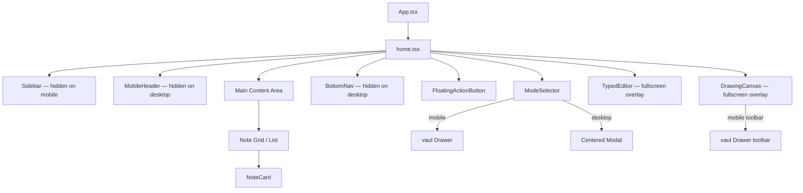

# Design Document: Mobile Responsive UI

## Overview

The MINO notes app currently renders a fixed-width left sidebar on all viewport sizes and relies on hover states that do not exist on touch devices. This design introduces a complete mobile-first responsive layer on top of the existing desktop layout without breaking any desktop behaviour.

The strategy is pure CSS-first: Tailwind responsive prefixes (`sm:`, `md:`, `lg:`) control all layout visibility and sizing decisions. JavaScript (`window.innerWidth`, `useIsMobile`) is removed from render logic and limited to functional side-effects such as preventing scroll during canvas drawing.

The result is three new components (`BottomNav`, `MobileHeader`, `BottomSheet`) and targeted modifications to five existing components (`home.tsx`, `NoteCard`, `FloatingActionButton`, `ModeSelector`, `DrawingCanvas`, `TypedEditor`).

### Key Design Decisions

1. **Tailwind-only layout switching** — `hidden sm:flex` / `flex sm:hidden` classes replace any `isMobile` conditional rendering. This keeps the component tree identical for both viewports and avoids hydration mismatches.
2. **Vaul Drawer for bottom sheets** — The project already has `vaul` (v0.9.9) as a dependency. `vaul` provides accessible, animated bottom sheets with a drag handle out of the box. `ModeSelector` and the DrawingCanvas mobile toolbar both use it.
3. **Safe-area insets via CSS env()** — `pb-[env(safe-area-inset-bottom)]` on `BottomNav` and `pt-[env(safe-area-inset-top)]` on `MobileHeader` handle notch/home-bar devices without JS.
4. **Touch drawing via pointer events** — The canvas uses unified `onPointerDown`/`onPointerMove`/`onPointerUp` handlers that work for both mouse and touch, replacing the mouse-only event set. `touch-action: none` on the canvas prevents page scroll while drawing.

---

## Architecture



### Layout Zones

| Zone | Mobile (< 640 px) | Desktop (≥ 640 px) |
|---|---|---|
| Left sidebar | hidden | `w-64 flex-shrink-0` |
| Top bar | `MobileHeader` (fixed) | `SearchBar` (sticky) |
| Bottom bar | `BottomNav` (fixed) | hidden |
| Content padding top | `pt-[56px]` (MobileHeader height) | `pt-0` |
| Content padding bottom | `pb-[64px]` (BottomNav height) | `pb-0` |
| Note grid columns | 1 col | `md:2` / `lg:3` |

---

## Components and Interfaces

### New Component: `BottomNav`

```tsx
// Breakpoint strategy: visible only below sm (640 px) using `flex sm:hidden`
interface BottomNavProps {
  activeSection: string;
  onSectionChange: (section: string) => void;
  onCalendarClick: () => void;
}
```

Renders four items: Home, Tasks, Pinned, Calendar.
- Fixed to bottom with `fixed bottom-0 left-0 right-0 z-40`.
- Each item is a `<button>` with `min-h-[56px] flex-1 flex flex-col items-center justify-center gap-1 py-2`.
- Active item uses filled icon variant + `text-indigo-600`.
- `pb-safe` (`pb-[env(safe-area-inset-bottom)]`) applied to the nav container.
- Calendar taps call `onCalendarClick` instead of `onSectionChange`.

### New Component: `MobileHeader`

```tsx
// Breakpoint strategy: visible only below sm (640 px) using `flex sm:hidden`
interface MobileHeaderProps {
  searchQuery: string;
  onSearchChange: (value: string) => void;
}
```

Two states managed internally:
1. **Default**: Logo (left), search-icon button + avatar button (right).
2. **Search expanded**: Text input replaces logo area, cancel button on right.

- Fixed to top with `fixed top-0 left-0 right-0 z-40 h-14 bg-white border-b`.
- All buttons use `min-w-[44px] min-h-[44px]` touch targets.
- Expanding/collapsing search is purely local state — no prop drilling needed.
- When search expands, the input receives auto-focus.

### Modified Component: `home.tsx`

Layout changes:
- Outer `div` changes from `flex h-screen` to `flex h-screen` (unchanged) but:
  - `<Sidebar>` wrapped in `<div className="hidden sm:flex">`.
  - `<MobileHeader>` added inside the right-side column with `className="flex sm:hidden"`.
  - `<SearchBar>` wrapped in `<div className="hidden sm:block">`.
  - `<BottomNav>` rendered after the content area with `className="flex sm:hidden"`.
  - Scrollable content area gets `sm:pt-0 pt-14 sm:pb-0 pb-16` for header/nav offsets.
- The dashed "New Note" grid card is conditionally hidden on mobile (`hidden sm:block` wrapper) per Requirement 4.6.

### Modified Component: `NoteCard`

Grid class changes in `home.tsx`:
```tsx
// Before
'grid grid-cols-1 md:grid-cols-2 lg:grid-cols-3 gap-4'
// After
'grid grid-cols-1 sm:grid-cols-2 lg:grid-cols-3 gap-4'
```

Per-card changes:
- Menu button `MoreVertical` loses `opacity-0 group-hover:opacity-100` and gains `sm:opacity-0 sm:group-hover:opacity-100 opacity-100` so it is always visible on mobile.
- Menu button `<button>` gains `min-w-[44px] min-h-[44px]` for touch target compliance.

### Modified Component: `FloatingActionButton`

```tsx
// Breakpoint strategy: bottom offset switches at sm breakpoint
// Mobile: bottom-20 (above BottomNav ~64px + 16px gap)
// Desktop: bottom-8 (existing)
```

Changed positioning class from `bottom-8 right-8` to `bottom-20 right-6 sm:bottom-8 sm:right-8`.
Size stays `w-14 h-14` (56 × 56 px) on all viewports.
Visibility: the FAB is already hidden when `ModeSelector` is open because the parent conditionally renders it.

### Modified Component: `ModeSelector`

Desktop behaviour is unchanged: centered modal via `sm:items-center`.

Mobile behaviour:
- Wraps the modal content in a `vaul` `<Drawer>` when on mobile. Since we use CSS-only breakpoints, both the `<Drawer>` (mobile) and the existing modal (desktop) are mounted simultaneously but only the correct one is visible:
  - Existing modal div keeps `hidden sm:flex`.
  - New `<Drawer>` wrapper keeps `flex sm:hidden` on its trigger/root.
- The `<Drawer.Content>` gets `rounded-t-3xl` and a `<div className="mx-auto mt-4 h-1.5 w-12 rounded-full bg-gray-300" />` drag handle.
- Each option button gets `min-h-[56px]` padding.

### Modified Component: `DrawingCanvas`

Header (back + save) is always visible, meeting Requirement 5.5.

Mobile toolbar (Requirement 5.1–5.2):
- The existing horizontal toolbar in the `<div>` header is wrapped `hidden sm:flex`.
- A new `<Drawer>` (vaul) renders `flex sm:hidden` — it contains the same tool controls in a horizontally-scrollable `overflow-x-auto flex gap-3 px-4 py-3` row.
- A compact floating toolbar strip is shown above the canvas on mobile: draw/erase toggle + currently selected color swatch + stroke dot + a "more tools" chevron to open the full drawer.

Touch drawing (Requirement 5.3–5.4):
- Canvas event handlers change from `onMouseDown/Move/Up/Leave` to `onPointerDown/Move/Up/Leave` so they fire for both mouse and touch input.
- `style={{ touchAction: 'none' }}` added to the `<canvas>` element to prevent scroll hijack.
- Pointer coordinate extraction uses `e.clientX`/`e.clientY` which works for both `PointerEvent` (mouse and touch).

Each toolbar button gains `min-w-[44px] min-h-[44px]`.

### Modified Component: `TypedEditor`

- Title input class: `text-3xl sm:text-4xl` (24 px on mobile, 36 px on desktop) meeting Requirement 6.1.
- Content area container: `min-h-[40dvh]` on mobile prevents keyboard from collapsing the editor — using `dvh` (dynamic viewport height) which adjusts as the software keyboard opens.
- Horizontal padding: `px-4 sm:px-8` applied to both the title wrapper and the editor wrapper.
- Header back button and save indicator already present — no structural change needed.

---

## Data Models

No new data models are introduced. The existing `Note`, `ViewMode`, `NoteType`, and `DateFilter` types are unchanged.

The only state additions are local to new/modified components:

| Component | New State | Type | Purpose |
|---|---|---|---|
| `MobileHeader` | `isSearchOpen` | `boolean` | Controls inline search expansion |
| `DrawingCanvas` | (none new) | — | Pointer event handlers replace mouse handlers; no new state |
| `home.tsx` | (none new) | — | `BottomNav` reuses existing `activeSection` / `onSectionChange` |

---

## Correctness Properties

*A property is a characteristic or behavior that should hold true across all valid executions of a system — essentially, a formal statement about what the system should do. Properties serve as the bridge between human-readable specifications and machine-verifiable correctness guarantees.*

### Property 1: Menu button always visible on mobile

*For any* `Note` object rendered inside a `NoteCard` on a Mobile_Viewport, the three-dot menu button SHALL be visible (i.e., it SHALL NOT carry `opacity-0` or any class that hides it from non-hovering users) regardless of note title, content, color, or type.

**Validates: Requirements 4.4**

### Property 2: FAB bottom offset above BottomNav

*For any* Mobile_Viewport state (any active section, any note list), the FAB's computed `bottom` CSS value SHALL be greater than or equal to the BottomNav height (64 px) plus 16 px (i.e., ≥ 80 px from the bottom of the viewport).

**Validates: Requirements 7.1**

### Property 3: Touch target minimum size across all interactive elements

*For any* interactive element designated as a Touch_Target in the mobile UI — including every `BottomNav` item, every `MobileHeader` button, the `NoteCard` menu button, every `ModeSelector` option button, and every `DrawingCanvas` toolbar button — its bounding rectangle width AND height SHALL both be ≥ 44 px.

**Validates: Requirements 2.8, 3.7, 4.5, 5.6, 8.4**

### Property 4: TypedEditor title font size on mobile

*For any* `Note` object (any title string, any content) rendered in `TypedEditor` on a Mobile_Viewport, the computed font size of the title `<input>` element SHALL be ≥ 24 px.

**Validates: Requirements 6.1**

### Property 5: MobileHeader search expand/collapse round trip

*For any* `MobileHeader` in its default (collapsed) state and any search query string, tapping the search icon SHALL expand the inline search input (searchOpen = true), and tapping the cancel button SHALL collapse it (searchOpen = false) AND clear the search query to an empty string — restoring the header exactly to its pre-expansion state.

**Validates: Requirements 3.2, 3.3**

### Property 6: BottomNav section-switching invariant

*For any* sequence of `BottomNav` item taps drawn from {Home, Tasks, Pinned, Calendar}: after processing the entire sequence, the active section SHALL equal the section ID of the last non-Calendar item tapped, and no Calendar tap in the sequence SHALL ever mutate the active section.

**Validates: Requirements 2.3, 2.6**

### Property 7: FAB minimum size on all viewports

*For any* viewport width (mobile or desktop), the FAB's rendered bounding rectangle width and height SHALL both be ≥ 56 px.

**Validates: Requirements 7.3**

---

## Error Handling

### Canvas Touch Event Failures
If `onPointerDown` fires but the canvas context is unavailable (e.g., canvas not yet mounted), drawing silently no-ops — the existing guard `if (!ctx) return` already handles this.

### Vaul Drawer Not Supported
`vaul` relies on standard browser APIs (pointer events, CSS transforms). All target mobile browsers (iOS Safari 15+, Chrome for Android 90+) support these. No fallback is needed, but if `<Drawer>` fails to render, the component falls back to the existing centered modal which is still in the DOM under `hidden sm:flex`.

### Safe-Area Insets Missing
If a device does not expose `env(safe-area-inset-bottom)`, the CSS property resolves to `0px`. The bottom nav will still be correctly padded by its explicit `pb-2` base padding.

### Software Keyboard Layout Shifts
Using `min-h-[40dvh]` instead of a fixed pixel value means the editor container adapts to the available visual viewport. If the browser does not support `dvh` units (Safari < 15.4), it gracefully falls back to `vh` without causing layout breakage — the editor may slightly overlap the keyboard in that edge case, which is acceptable.

---

## Testing Strategy

This feature is primarily a **layout and UI** change — new components, Tailwind responsive classes, and event handler replacements. The appropriate testing mix is:

### Unit / Example-Based Tests

- **MobileHeader state transitions**: verify that `isSearchOpen` toggles correctly and the search query clears on cancel.
- **BottomNav active item**: verify that clicking each nav item calls `onSectionChange` with the correct section ID, and Calendar calls `onCalendarClick` instead.
- **FAB positioning class**: verify the FAB renders with `bottom-20` class on mobile and `sm:bottom-8` on desktop.
- **NoteCard menu visibility**: verify the menu button does not have `opacity-0` on mobile (no group-hover dependency).

### Property-Based Tests

The feature includes pure-logic elements suitable for property-based testing. The project has no existing PBT library; **Vitest + fast-check** is the recommended addition (fast-check works with Vitest out of the box via standard test runners).

Install: `npm install --save-dev @vitest/run fast-check`

Minimum 100 iterations per property test. Each test is tagged with a comment referencing its design property.

**Feature: mobile-responsive-ui, Property 1: menu button visibility invariant**
```
// For any NoteCard props with viewMode 'grid' or 'list',
// the rendered menu button className should not contain 'opacity-0' when
// window.innerWidth is below 640.
```

**Feature: mobile-responsive-ui, Property 3: touch target minimum size**
```
// For any rendered interactive element in BottomNav / MobileHeader,
// fc.property(fc.integer({ min: 320, max: 639 }), ...) — at any mobile width,
// getBoundingClientRect().width and .height >= 44.
```

**Feature: mobile-responsive-ui, Property 5: search expand/collapse round trip**
```
// For any arbitrary sequence of toggle actions, the final state of
// isSearchOpen and searchQuery must be consistent with the last action applied.
```

**Feature: mobile-responsive-ui, Property 6: BottomNav active section**
```
// For any sequence of nav item taps (generated as an array of section IDs),
// after all taps the active section equals the last non-calendar tap,
// and the calendar tap count does not change activeSection.
```

### Integration Tests

- Render `home.tsx` at 375 px width (mobile) and verify: Sidebar absent from DOM layout, BottomNav present, MobileHeader present, SearchBar absent.
- Render `home.tsx` at 1024 px width (desktop) and verify: Sidebar present, BottomNav absent, MobileHeader absent, SearchBar present.
- Verify DrawingCanvas pointer events: simulate `pointerdown`, `pointermove`, `pointerup` on the canvas element and confirm `isDrawing` state transitions correctly.

### Accessibility
- Run axe-core against MobileHeader, BottomNav, and ModeSelector bottom-sheet to verify ARIA labels and focus management.
- Manual testing with VoiceOver (iOS) and TalkBack (Android) is required to fully validate — automated tools cannot verify all screen-reader behaviors.
